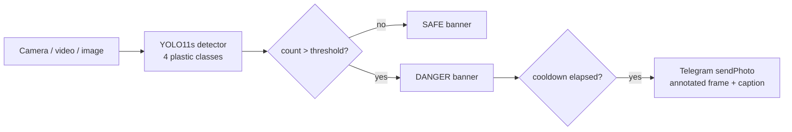

# 🌊 RiverGuard

**Real-time plastic waste detection for rivers, with Telegram early-warning alerts.**

RiverGuard watches a camera feed of a river or floodgate and counts floating plastic with a fine-tuned YOLO11 model.
When more items than the safe limit are visible, it sends a Telegram alert with an evidence photo so cleanup crews
can act *before* the build-up blocks a floodgate.

**[▶ Live demo on Hugging Face](https://huggingface.co/spaces/HF_USERNAME/riverguard)** · **[🎥 Project video](VIDEO_URL)**

<p align="center">
  
  
</p>

## Why

Urban rivers in Indonesia carry large amounts of macroplastic. When it piles up at floodgates it blocks the flow and
makes floods worse. Many floodgates already have CCTV, but it's used for passive recording, and operators have to
watch the screens to notice a build-up. RiverGuard turns that existing camera into an active sensor that notifies
the crew when the waste count passes a safe limit.

## How it works



1. Each frame is run through the detector (confidence ≥ 0.35 by default). Large photos are also scanned as
   overlapping 640 px tiles, so small, distant items keep enough pixels to be recognised. Duplicate boxes where
   tiles overlap are merged.
2. Detections are counted per class and drawn on the frame with a SAFE / DANGER status banner.
3. If the count is **above** the threshold (default 5), the annotated frame is sent to a Telegram chat, at most once
   per cooldown window (default 20 s) so a single build-up doesn't flood the chat.

## Model

| | |
|---|---|
| Base model | YOLO11s (COCO-pretrained, Ultralytics) |
| Classes | `other_plastic`, `plastic_bag`, `plastic_bottle`, `plastic_package` |
| Data | Public river-trash dataset from Roboflow |
| Training | 64 epochs, 640 px, batch 16, lr 0.01 → 0.0001, Google Colab T4 (~1 h) |
| Validation | **Precision 0.845 · Recall 0.725 · mAP50 0.828 · mAP50-95 0.656** |

Weights: [`models/best.pt`](models/best.pt) (19 MB).

### How well does it work on real rivers?

The validation score above comes from the same dataset the model trained on. To measure the real use case, I
built two extra test sets of river photos from Wikimedia Commons and Roboflow Universe. Each is scored by whether
RiverGuard makes the right SAFE/DANGER call:

| Test set | Correct SAFE/DANGER calls | Missed alerts |
|---|---|---|
| Original test split (273 images) | 96.3% | 5 of 21 |
| Real river scenes, 0–30 items (17 photos, tiled) | 94.1% | 1 of 5 |
| Trash-carpeted rivers (66 photos, tiled) | 36.4% | 42 of 50 |

**It is reliable for scattered litter and blind to rivers carpeted with trash.** I tried to fix that by
retraining on about 10,000 more images plus 51 hand-labeled dense-trash photos, and by adding a "dense trash"
class. Neither beat the original model on held-out rivers, so v1 still ships. The full experiment, with numbers
and diagnosis, is in [training/README.md](training/README.md).

## Quickstart

Requires Python 3.10+.

```bash
git clone https://github.com/GITHUB_USERNAME/RiverGuard.git
cd RiverGuard
python -m venv .venv
.venv\Scripts\activate          # Windows  (macOS/Linux: source .venv/bin/activate)
pip install -r requirements.txt
```

**Local monitor** (OpenCV window, sends real alerts if configured):

```bash
python run_camera.py --source 0                         # webcam
python run_camera.py --source examples/canal-litter.jpg     # image
python run_camera.py --source river.mp4 --threshold 8   # video file
python run_camera.py --source rtsp://camera/stream --no-show   # headless next to a CCTV
```

Press `q` to quit. Run `python run_camera.py --help` for all options.

**Web app** (the same app that runs on Hugging Face):

```bash
python app.py        # then open http://127.0.0.1:7860
```

### Telegram alerts

1. Create a bot with [@BotFather](https://t.me/BotFather) (`/newbot`) and copy the token.
2. Send your bot a message, then open `https://api.telegram.org/bot<TOKEN>/getUpdates` and copy `chat.id`.
   For a group, add the bot to the group first; group IDs start with `-`.
3. `cp .env.example .env` and fill in `TELEGRAM_TOKEN` and `TELEGRAM_CHAT_ID`.

Without these, everything still runs. Alerts are skipped, and the web app shows a preview of the message instead.

## Project structure

```
riverguard/        core package: config, detector, drawing, Telegram alerts
run_camera.py      local monitor CLI (webcam / video / image / RTSP)
app.py             Gradio web app (Hugging Face Space entrypoint)
models/best.pt     trained weights
examples/          sample images (see examples/ATTRIBUTION.md)
deploy/            Hugging Face Space deploy script + Space card
training/          v2 retraining pipeline: dataset builder, auto-labeling, Kaggle notebook, evaluation
tests/             pytest suite (pytest -q)
```

## Deployment

The live demo is a free CPU Hugging Face Space. Every push to `main` runs the tests and redeploys it
([workflow](.github/workflows/deploy-space.yml)) when the `HF_SPACE` repository variable and `HF_TOKEN` secret are set.
To deploy by hand, run `hf auth login` and then `deploy/deploy_space.sh <user>/riverguard`.

The public Space intentionally has **no** Telegram secrets, so visitors see an alert preview and never message a real
chat.

## Limitations & next steps

- **Dense trash goes undetected** (see [above](#how-well-does-it-work-on-real-rivers)). The most promising fix is
  a few hundred labeled dense-trash photos from many different rivers. Murky water and night-time footage are
  also untested.
- Alerts use a simple item count. The original proposal also described a three-level scale (safe / warning / danger)
  based on density and GPS-tagged alerts, and neither is implemented yet.
- Counting is per frame, so the same bottle is re-counted as it drifts past. Tracking (e.g. ByteTrack) would allow
  counting unique items over time.

## Background

RiverGuard started as a 3-person group project for the Artificial Intelligence course at BINUS University
(3rd semester, January 2026). This repository is a cleaned-up and deployed version of that prototype.

## License

[AGPL-3.0](LICENSE), inherited from [Ultralytics YOLO](https://github.com/ultralytics/ultralytics). Example images
are licensed separately, see [examples/ATTRIBUTION.md](examples/ATTRIBUTION.md).
