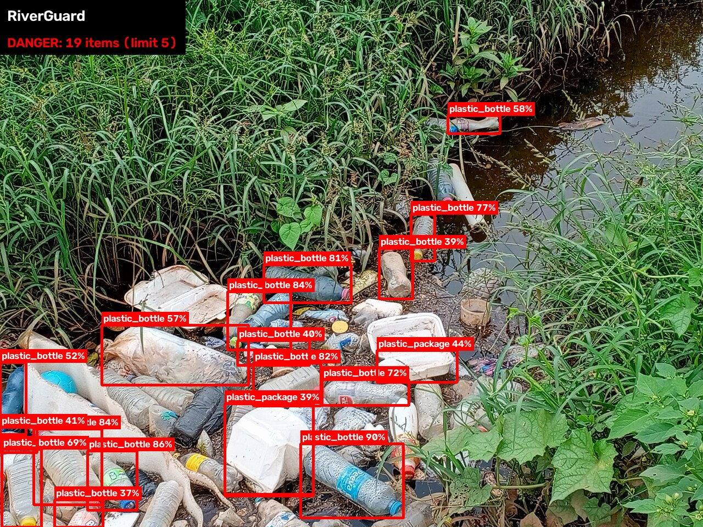
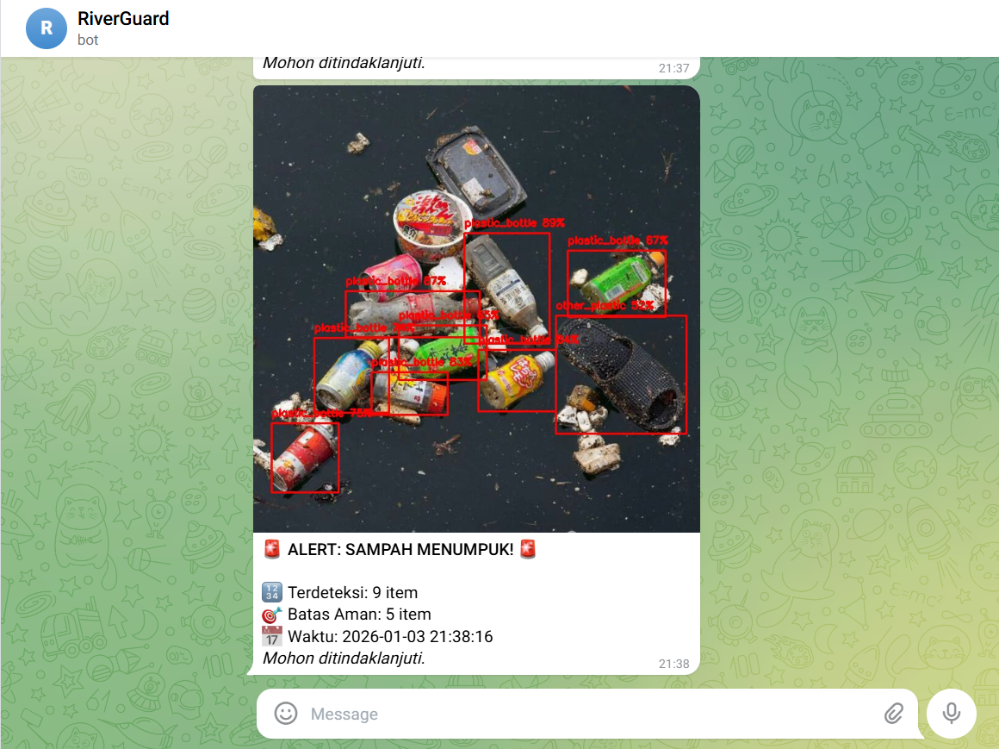
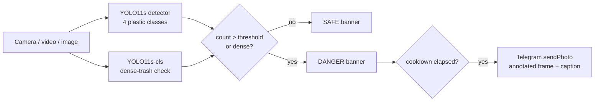

# 🌊 RiverGuard

**Real-time plastic waste detection for rivers, with Telegram early-warning alerts.**

RiverGuard watches a camera feed of a river or floodgate. A fine-tuned YOLO11 detector counts floating plastic, and a
second model checks whether the water is carpeted with trash too dense to count. When either says the river is over
the limit, it sends a Telegram alert with an evidence photo so cleanup crews can act *before* the build-up blocks a
floodgate.

**[▶ Try the live demo](https://riverguard.streamlit.app/)** (free hosting: if it has been idle, click the wake-up
button and give it about a minute)

<p align="center">
  
  
</p>

## Why

Urban rivers in Indonesia carry large amounts of macroplastic. When it piles up at floodgates it blocks the flow and
makes floods worse. Many floodgates already have CCTV, but it's used for passive recording, and operators have to
watch the screens to notice a build-up. RiverGuard turns that existing camera into an active sensor that notifies
the crew when the waste count passes a safe limit.

## How it works



1. Each frame is run through the detector (confidence ≥ 0.35 by default). Large photos are also scanned as
   overlapping 640 px tiles, so small, distant items keep enough pixels to be recognised. A box cut off by a
   tile's edge is dropped, because the full frame or the neighbouring tile sees that item whole, and duplicate
   boxes where tiles overlap are merged. Boxes that cover a face are dropped too (see Limitations).
2. The whole frame also goes through a small classifier that answers one question: *is the water carpeted with
   trash?* That catches scenes where items are packed too tightly for the detector to count.
3. Detections are counted per class and drawn on the frame with a SAFE / DANGER status banner.
4. If the count is **above** the threshold (default 5), **or** the dense-trash score is at least 50%, the annotated
   frame is sent to a Telegram chat, at most once per cooldown window (default 20 s) so a single build-up doesn't
   flood the chat.

## Models

| | Item detector ([`models/best.pt`](models/best.pt), 19 MB) | Dense-trash check ([`models/density.pt`](models/density.pt), 11 MB) |
|---|---|---|
| Base model | YOLO11s (COCO-pretrained) | YOLO11s-cls (ImageNet-pretrained) |
| Output | Boxes: `other_plastic`, `plastic_bag`, `plastic_bottle`, `plastic_package` | P(water carpeted with trash) |
| Data | Public river-trash dataset from Roboflow | ~1,100 openly licensed photos from 160+ photographers (Openverse, Wikimedia Commons, Roboflow Universe), tagged dense / not dense |
| Training | 64 epochs, 640 px, Google Colab T4 | 384 px, Kaggle T4, split by photographer |
| Validation | Precision 0.845 · Recall 0.725 · mAP50 0.828 | Threshold 0.5 chosen on held-out photographers |

### How well does it work on real rivers?

The detector's validation score comes from the same dataset it trained on. To measure the real use case, I built
three extra test sets of river photos that no model trained on. Each is scored by whether RiverGuard makes the
right SAFE/DANGER call:

| Test set | Detector only | **Detector + dense check (shipped)** |
|---|---|---|
| Trash-carpeted rivers (66 photos, 50 should alert) | 36.4% · 42 missed | **78.8% · 14 missed · 0 false alarms** |
| Unseen photographers (108 photos, 10 should alert) | 91.7% · 9 missed | **97.2% · 1 missed · 2 false alarms** |
| Real river scenes, 0–30 items (17 photos) | 94.1% | 88.2% (1 false alarm) |
| Original test split (273 images) | 96.3% · 5 false alarms | 93.8% · 12 false alarms |

**The dense check turns RiverGuard from blind to trash-carpeted rivers into catching about three in four**, at the
cost of a few extra false alarms on close-up photos of litter. For a flood early-warning system a missed blockage is
the expensive mistake, and the alert cooldown keeps occasional false alarms from spamming the crew. The full
experiment history, including two retraining attempts that failed and why, is in [training/README.md](training/README.md).

## Quickstart

Requires Python 3.10+.

```bash
git clone https://github.com/Alb138/RiverGuard.git
cd RiverGuard
python -m venv .venv
.venv\Scripts\activate          # Windows  (macOS/Linux: source .venv/bin/activate)
pip install -r requirements.txt
```

**Local monitor** (OpenCV window, sends real alerts if configured):

```bash
python run_camera.py --source 0                         # webcam
python run_camera.py --source examples/versailles-pond.jpg  # image
python run_camera.py --source river.mp4 --threshold 8   # video file
python run_camera.py --source rtsp://camera/stream --no-show   # headless next to a CCTV
```

Press `q` to quit. Run `python run_camera.py --help` for all options.

**Web app** (Gradio; sends real alerts if configured, unlike the public demo):

```bash
python app.py        # then open http://127.0.0.1:7860
```

### Telegram alerts

1. Create a bot with [@BotFather](https://t.me/BotFather) (`/newbot`) and copy the token.
2. Send your bot a message, then open `https://api.telegram.org/bot<TOKEN>/getUpdates` and copy `chat.id`.
   For a group, add the bot to the group first; group IDs start with `-`.
3. `cp .env.example .env` and fill in `TELEGRAM_TOKEN` and `TELEGRAM_CHAT_ID`.

Without these, everything still runs. Alerts are skipped, and the web app shows a preview of the message instead.

## Project structure

```
riverguard/        core package: config, detector + model runtimes, drawing, Telegram alerts, web helpers
run_camera.py      local monitor CLI (webcam / video / image / RTSP)
app.py             Gradio web app (local, with real alerts)
demo/              the public demo: Streamlit app + its slim requirements
models/            best.pt (item detector) + density.pt (dense-trash check), and their ONNX exports
examples/          sample images (see examples/ATTRIBUTION.md)
training/          data collection, labeling tools, dataset builders, Kaggle notebooks, evaluation
tests/             pytest suite (pytest -q)
```

## Deployment

The [live demo](https://riverguard.streamlit.app/) is [`demo/streamlit_app.py`](demo/streamlit_app.py) on the free
[Streamlit Community Cloud](https://streamlit.io/cloud), which updates it on every push to `main`. It installs only
[`demo/requirements.txt`](demo/requirements.txt): no PyTorch, because it runs ONNX exports of both models on plain
onnxruntime ([`riverguard/backends.py`](riverguard/backends.py)), which uses far less memory and starts faster.
The [tests](.github/workflows/tests.yml) check that the exports give the same boxes and scores as the `.pt` models,
and load the demo page with exactly the packages the cloud installs. After 12 hours without visitors the app goes to
sleep; the next visitor wakes it with one click, which takes about a minute.

To run the demo locally (Python 3.11+):

```bash
pip install -r demo/requirements.txt
streamlit run demo/streamlit_app.py
```

After replacing a model, re-export the ONNX files (needs the full `requirements.txt` plus `pip install onnx onnxslim`):

```bash
python -c "from ultralytics import YOLO; YOLO('models/best.pt').export(format='onnx', dynamic=True, simplify=True)"
python -c "from ultralytics import YOLO; YOLO('models/density.pt').export(format='onnx', imgsz=384, simplify=True)"
```

The public demo never sends Telegram alerts (it doesn't read credentials at all), so visitors see an alert preview
and never message a real chat.

## Limitations & next steps

- **The dense check still misses about one in four trash-carpeted scenes** and sometimes fires on close-up photos
  of a few items. It was trained on only ~100 dense photos; more varied dense examples are the main lever (a third
  round with more "not dense" photos made it more cautious rather than better, see
  [training/README.md](training/README.md)). Murky water and night-time footage are untested.
- **The item detector has only ever seen rivers.** It never saw a person, so it boxed faces as trash (12 of 16 test
  selfies), and its four classes are all plastic, so a drink can comes out as `plastic_bottle`. For now a small face
  detector ([YuNet](https://github.com/opencv/opencv_zoo/tree/main/models/face_detection_yunet), MIT licence) drops
  boxes that cover a face; on the river test sets it changed no SAFE/DANGER call. The real fix is a retrain with
  photos of people as negative examples and an `other_trash` class for cans and glass.
- The original proposal also described a three-level scale (safe / warning / danger) and GPS-tagged alerts; neither
  is implemented yet.
- Counting is per frame, so the same bottle is re-counted as it drifts past. Tracking (e.g. ByteTrack) would allow
  counting unique items over time.

## Background

RiverGuard started as a 3-person group project for the Artificial Intelligence course at BINUS University
(3rd semester, January 2026). This repository is a cleaned-up and deployed version of that prototype.

## License

[AGPL-3.0](LICENSE), inherited from [Ultralytics YOLO](https://github.com/ultralytics/ultralytics). The YuNet face
model is MIT-licensed ([its licence](models/face_detection_yunet_2023mar.LICENSE)). Images are licensed separately: see [examples/ATTRIBUTION.md](examples/ATTRIBUTION.md) and the training credits in
[training/ATTRIBUTION.md](training/ATTRIBUTION.md) and [training/DENSITY_ATTRIBUTION.md](training/DENSITY_ATTRIBUTION.md).
