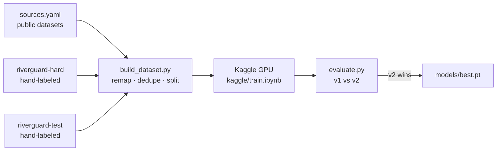

# Training RiverGuard v2

v1 finds individual floating items well, but misses most items in dense piles and wide shots.
v2 retrains on more varied data plus hand-labeled hard examples, and is **only shipped if it beats v1 on a
held-out test set** of real river scenes.

> **Outcome (September 2026): v2 did not beat v1, so v1 still ships.** Tiled inference was the one measured
> improvement, and the app now uses it for photos. The [results](#v2-results) section explains why retraining
> didn't help and what would.



## How "better" is measured

| Test set | What's in it | Labels | Metrics |
|---|---|---|---|
| **In-domain** | The base dataset's own held-out test split (273 images) | full boxes | mAP, count error, SAFE/DANGER accuracy. Checks v2 didn't get worse at v1's job. |
| **Tier A** (`riverguard-test`) | Real river scenes with 0–30 items, from Wikimedia Commons | full boxes | same as above, on the target domain |
| **Tier B** | Dense or clean river scenes where boxing every item is impossible or pointless | one tag per image: `danger` / `safe` / `none` | SAFE/DANGER accuracy, missed alerts, false alerts |

"Alarm" metrics run the images through the app's own code path (1280 px downscale, confidence 0.35,
alert above 5 items), so they predict what a user would actually see.

### v1 baseline

| Test set | mAP50 | SAFE/DANGER correct | Missed alerts | False alerts |
|---|---|---|---|---|
| In-domain (273 images, 21 DANGER) | 0.828 | 96.3% | 5 | 5 |
| Tier A (17 real water scenes, 5 DANGER) | **0.251** | 82.4% | 3 / 5 | 0 |
| Tier A, tiled inference | — | 94.1% | 1 / 5 | 0 |
| Tier B (66 river photos, 50 DANGER) | — | **28.8%** | **47 / 50** | 0 |
| Tier B, tiled inference | — | 36.4% | 42 / 50 | 0 |

v1 does its original job well, but almost never raises the alarm for a trash-carpeted river. Tiled inference
helps on full-resolution photos (on the 1024–1280 px Commons images, missed alerts drop from 13/15 to 8/15 with no
new false alarms). The 640 px rakadata images are too small for tiling to kick in.

### v2 results

Two models were trained on Kaggle (YOLO11s, 640 px, early stopping after 25 epochs without improvement):

- **v2a**: v1's data plus three more public datasets (harbour, lake and drone footage), about 9,600 training images.
- **v2b**: v2a's data plus 51 hand-labeled Marilao River photos (oversampled 6×), using a 5th class, `trash_patch`,
  for trash carpets too dense to count.

| Model | In-domain mAP50 | In-domain SAFE/DANGER | Tier A mAP50 | Tier A SAFE/DANGER (tiled) | Tier B SAFE/DANGER (tiled) |
|---|---|---|---|---|---|
| **v1** (shipped) | **0.828** | 96.3% | **0.251** | **94.1%** | **36.4%**, 42/50 missed, 0 false |
| v2a | 0.813 | 97.1% | 0.224 | 94.1% | 33.3%, 44/50 missed, 0 false |
| v2b | 0.825 | **97.4%** | 0.242 | 94.1% | 33.3%, 42/50 missed, 2 false |

Neither retrain moved the target metric, tier B. Two diagnoses explain why:

1. **Adding more of the same kind of data doesn't help.** The extra public datasets are mostly close-up or
   harbour scenes of individual items, so the model got a little different but not better on trash-carpeted
   rivers. (One of them labels dense regions as "Undefined trash" with wave-sized boxes, which was dropped.)
2. **51 photos from one river aren't enough for a new concept.** v2b learned `trash_patch` well on Marilao
   itself (validation mAP50 0.63), but on other rivers its patch confidence is near zero: it fired on only
   3 of 50 dense test scenes, and on 1 clean one. One photographer on one stretch of river is a single
   visual domain, and the model memorised it.

**What would likely work next:** dense-trash photos from *many* different rivers (a few hundred, rather than
51 from one). Other options are a density-regression or segmentation head instead of boxes, or a larger model
with tiled training. The pipeline in this folder supports all of that; the bottleneck is labeled data.

## Setup

Keys go in `.env` (see `.env.example`): `ROBOFLOW_API_KEY` and `KAGGLE_API_TOKEN`.

```bash
pip install -r requirements-dev.txt                       # app + training tools (Python 3.10)
py -3.13 -m venv .venv-tools && .venv-tools/Scripts/pip install kaggle   # Kaggle CLI needs Python 3.11+
```

## Steps

1. **Collect and pre-label hard images.** Dense photos are first cut into 640 px crops that can be
   labeled completely. The current model then draws first-draft boxes, so you only correct them:
   ```bash
   python training/make_crops.py datasets/hard-src datasets/hard-raw --per-image 4
   python training/prelabel.py datasets/test-raw --project riverguard-test --split test
   python training/prelabel.py datasets/hard-raw --project riverguard-hard
   ```
2. **Label in Roboflow** following [LABELING.md](LABELING.md), then generate a version of each project.
3. **Build the merged dataset** from [sources.yaml](sources.yaml):
   ```bash
   python training/build_dataset.py        # -> datasets/riverguard-v2/ + riverguard-v2.zip
   ```
4. **Upload it to Kaggle and train** (about 1–3 h on a free T4). The notebook is [kaggle/train.ipynb](kaggle/train.ipynb):
   ```bash
   training/kaggle.sh datasets create -p <upload-dir>      # first time; later: datasets version
   training/kaggle.sh kernels push -p <kernel-dir>
   training/kaggle.sh kernels status <user>/riverguard-v2-train
   training/kaggle.sh kernels output <user>/riverguard-v2-train -p runs/kaggle
   ```
5. **Compare v1 and v2** on the same test set, both as a detector and as an alarm:
   ```bash
   python training/evaluate.py --data datasets/riverguard-v2/data.yaml models/best.pt runs/kaggle/best.pt
   ```
   The alarm columns are what matter for the product: `decision_accuracy` (SAFE/DANGER called correctly),
   `missed_alerts` (DANGER scenes called SAFE, the costly error) and `count_mae`.
6. If v2 wins, replace `models/best.pt`, update the model card in the main README, and push. CI redeploys the Space.
