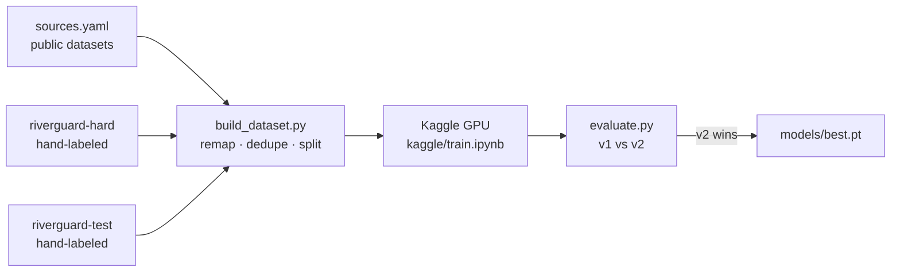

# Training RiverGuard

v1 finds individual floating items well, but misses most items in dense piles and wide shots. Every new model here
is **only shipped if it beats v1 on held-out test sets** of real river scenes.

> **Outcome (October 2026):** the item detector is still v1 (two retrains, [v2](#v2-results), didn't beat it), now
> run with tiled inference. A separate whole-photo **dense-trash classifier** ([v3](#v3-dense-trash-classifier))
> ships alongside it and raises alarm accuracy on trash-carpeted rivers from 36% to 79%.



## How "better" is measured

| Test set | What's in it | Labels | Metrics |
|---|---|---|---|
| **In-domain** | The base dataset's own held-out test split (273 images) | full boxes | mAP, count error, SAFE/DANGER accuracy. Checks v2 didn't get worse at v1's job. |
| **Tier A** (`riverguard-test`) | Real river scenes with 0–30 items, from Wikimedia Commons | full boxes | same as above, on the target domain |
| **Tier B** | Dense or clean river scenes where boxing every item is impossible or pointless | one tag per image: `danger` / `safe` / `none` | SAFE/DANGER accuracy, missed alerts, false alerts |

"Alarm" metrics run the images through the app's own code path (1280 px downscale, confidence 0.35,
alert above 5 items), so they predict what a user would actually see.

### v1 baseline

| Test set | mAP50 | SAFE/DANGER correct | Missed alerts | False alerts |
|---|---|---|---|---|
| In-domain (273 images, 21 DANGER) | 0.828 | 96.3% | 5 | 5 |
| Tier A (17 real water scenes, 5 DANGER) | **0.251** | 82.4% | 3 / 5 | 0 |
| Tier A, tiled inference | — | 94.1% | 1 / 5 | 0 |
| Tier B (66 river photos, 50 DANGER) | — | **28.8%** | **47 / 50** | 0 |
| Tier B, tiled inference | — | 36.4% | 42 / 50 | 0 |

v1 does its original job well, but almost never raises the alarm for a trash-carpeted river. Tiled inference
helps on full-resolution photos (on the 1024–1280 px Commons images, missed alerts drop from 13/15 to 8/15 with no
new false alarms). The 640 px rakadata images are too small for tiling to kick in.

### v2 results

Two models were trained on Kaggle (YOLO11s, 640 px, early stopping after 25 epochs without improvement):

- **v2a**: v1's data plus three more public datasets (harbour, lake and drone footage), about 9,600 training images.
- **v2b**: v2a's data plus 51 hand-labeled Marilao River photos (oversampled 6×), using a 5th class, `trash_patch`,
  for trash carpets too dense to count.

| Model | In-domain mAP50 | In-domain SAFE/DANGER | Tier A mAP50 | Tier A SAFE/DANGER (tiled) | Tier B SAFE/DANGER (tiled) |
|---|---|---|---|---|---|
| **v1** (shipped) | **0.828** | 96.3% | **0.251** | **94.1%** | **36.4%**, 42/50 missed, 0 false |
| v2a | 0.813 | 97.1% | 0.224 | 94.1% | 33.3%, 44/50 missed, 0 false |
| v2b | 0.825 | **97.4%** | 0.242 | 94.1% | 33.3%, 42/50 missed, 2 false |

Neither retrain moved the target metric, tier B. Two diagnoses explain why:

1. **Adding more of the same kind of data doesn't help.** The extra public datasets are mostly close-up or
   harbour scenes of individual items, so the model got a little different but not better on trash-carpeted
   rivers. (One of them labels dense regions as "Undefined trash" with wave-sized boxes, which was dropped.)
2. **51 photos from one river aren't enough for a new concept.** v2b learned `trash_patch` well on Marilao
   itself (validation mAP50 0.63), but on other rivers its patch confidence is near zero: it fired on only
   3 of 50 dense test scenes, and on 1 clean one. One photographer on one stretch of river is a single
   visual domain, and the model memorised it.

**What would likely work next:** dense-trash photos from *many* different rivers (a few hundred, rather than
51 from one). Other options are a density-regression or segmentation head instead of boxes, or a larger model
with tiled training. The pipeline in this folder supports all of that; the bottleneck is labeled data.

### v3: dense-trash classifier

Instead of boxing carpets of trash, v3 adds a second, whole-photo model that answers one question: *is the water
carpeted with trash?* One tag per photo is far cheaper to label than boxes, so it can learn from many rivers.

**Data.**
- About 9,000 candidate photos were collected (`collect_candidates.py`) from Openverse (Flickr), Wikimedia Commons
  and labeled Roboflow Universe datasets. Only reuse-and-modify licenses were kept: CC BY, BY-SA, CC0, public domain
  and MIT.
- They were screened on contact sheets (`sheets.py`) into dense / scattered / clean / reject. Only about 2–4% of
  "polluted river" search results are truly dense.
- `build_density.py` then:
  - caps photos per photographer
  - drops near-duplicates and any photo resembling a test image
  - splits by **photographer**, so the held-out test ("tier C") checks generalization to photographers and rivers
    it never saw.
- Training is `kaggle/train_density.ipynb`: YOLO11s-cls at 384 px. The alert threshold is chosen on the validation
  photographers only.

| Alarm = items > 5 **or** dense | Tier B (66, 50 dense) | Tier C (108, 10 dense) | Tier A (17) | In-domain (273) |
|---|---|---|---|---|
| v1 + tiling (no dense check) | 36.4% · 42 missed · 0 false | 91.7% · 9 missed · 0 false | 94.1% · 0 false | 96.3% · 5 false |
| **+ v3b** (shipped): 79 dense / 876 not, 129 photographers | **78.8% · 14 missed · 0 false** | **97.2% · 1 missed** · 2 false | 88.2% · 1 false | 93.8% · 12 false |
| + v3c: 102 dense / 1,045 not, 230 photographers | 69.7% · 19 missed · 1 false | 94.4% · 6 missed · **0 false** | **94.1% · 0 false** | 94.9% · 9 false |

v3a (the first run) found the failure mode: close-ups of a single item on cluttered ground were called "dense". v3b
fixed most of it with ~180 close-up negatives and 4× oversampled dense photos.

v3c added ~120 more photographers, including clean Jakarta and Ciliwung rivers and ~800 close-ups. It became more
**cautious rather than better**: fewer false alarms, but it missed more real carpets, catching only 4 of 10 on
unseen photographers. v3b ships because a missed blockage is the costly error for an early-warning system. Its one
shortfall against the ship criteria is in-domain accuracy, 2.5 points below v1 instead of ≤ 1. The next step is
more *dense* examples from varied rivers; more negatives alone won't help.

### v4: people, cans and look-alikes (item detector)

Once the demo was public, two failures showed up that the test sets above never measured: the webcam boxed
visitors' faces as `other_plastic`, and a drink can came out as `plastic_bottle`. v1 had never seen a person, and
all four of its classes are plastic.

- **`other_trash` class.** Two of the public datasets already box cans and metal (about 2,300 boxes); v1 and v2
  dropped them. v4 maps them to a 5th class ([sources-v4.yaml](sources-v4.yaml)). A SAM 3 audit of v1's own data
  found only a handful of cans labelled as plastic, not worth relabelling.
- **Photos of people with nothing to box.** [collect_negatives.py](collect_negatives.py) found 977 openly licensed
  Commons photos (selfies, portraits, crowds, kayakers, ferry passengers). Screening removed 297: paintings, and
  anything showing cups, bottles or bags, which would teach the model to ignore real trash. 511 train, 118 are a
  held-out test, split by photographer ([credits](NEGATIVES_ATTRIBUTION.md)).
- **Fine-tuned from v1** (`init.pt` in the Kaggle dataset), 73 epochs.

v4 then called small white shapes plastic (coins on a lily pad, a cloud), so **v4b** tried a fix: a 330-photo
look-alike set (clouds, swans, gulls, egrets, sails, ice, lily pads, foam) and less of the lake footage whose
distant bottles are white specks ([sources-v4b.yaml](sources-v4b.yaml)).

| Alarm = items > 5 **or** dense (tiled) | **v1** (shipped) | v4 | v4b |
|---|---|---|---|
| In-domain (273) | 93.8% · 5 missed · 12 false | **94.5% · 5 · 10** | 93.4% · 6 · 12 |
| Tier A (17) | **88.2% · 1 · 1** | 82.4% · 1 · 2 | 82.4% · 1 · 2 |
| Tier B (66) | 78.8% · 14 · 0 | **80.3% · 13 · 0** | 78.8% · 14 · 0 |
| Tier C (108) | 97.2% · 1 · 2 | 97.2% · 1 · 2 | 97.2% · 1 · 2 |
| Held-out cans called `other_trash` (84) | 0% (87% missed) | **83%** | 71% |
| Held-out people photos with any box (118) | 65% | **5%** | 5% |
| Held-out look-alikes with any box (46) | 33% | 17% | **13%** |
| Test selfies with a box (16) | 12 | **1** | — |

v4 fixes both reported failures and is equal or better everywhere except tier A, where the coins on a lily pad
became 6 "plastic bags" (one extra false alarm), and it boxes a small cloud in one of the demo photos. It was
shipped briefly and then rolled back: **v1 stays the shipped detector**, with the face filter covering the webcam
case, and v4's weights stay in `runs/kaggle-v4/`. v4b fixed the cloud and halved look-alike boxes, but lost cans
and in-domain accuracy, and still alarmed on the coins.

Collecting more *dense* photos for the classifier (piles of trash on river banks, which v3b misses) was tried in the
same round: about 600 title-matched Commons photos, ranked by v3b, yielded 6 new dense scenes. Commons search results
for "river trash" are mostly bins, landfills, cleanup events and a synth-music meetup. A stock-photo source (e.g. the
Pexels API) would be the next step.

## Setup

Keys go in `.env` (see `.env.example`): `ROBOFLOW_API_KEY` and `KAGGLE_API_TOKEN`.

```bash
pip install -r requirements-dev.txt                       # app + training tools (Python 3.10)
py -3.13 -m venv .venv-tools && .venv-tools/Scripts/pip install kaggle   # Kaggle CLI needs Python 3.11+
```

## Steps

1. **Collect and pre-label hard images.** Dense photos are first cut into 640 px crops that can be
   labeled completely. The current model then draws first-draft boxes, so you only correct them:
   ```bash
   python training/make_crops.py datasets/hard-src datasets/hard-raw --per-image 4
   python training/prelabel.py datasets/test-raw --project riverguard-test --split test
   python training/prelabel.py datasets/hard-raw --project riverguard-hard
   ```
2. **Label in Roboflow** following [LABELING.md](LABELING.md), then generate a version of each project.
3. **Build the merged dataset** from [sources.yaml](sources.yaml):
   ```bash
   python training/build_dataset.py        # -> datasets/riverguard-v2/ + riverguard-v2.zip
   ```
4. **Upload it to Kaggle and train** (about 1–3 h on a free T4). The notebook is [kaggle/train.ipynb](kaggle/train.ipynb):
   ```bash
   training/kaggle.sh datasets create -p <upload-dir>      # first time; later: datasets version
   training/kaggle.sh kernels push -p <kernel-dir>
   training/kaggle.sh kernels status <user>/riverguard-v2-train
   training/kaggle.sh kernels output <user>/riverguard-v2-train -p runs/kaggle
   ```
5. **Compare v1 and v2** on the same test set, both as a detector and as an alarm:
   ```bash
   python training/evaluate.py --data datasets/riverguard-v2/data.yaml models/best.pt runs/kaggle/best.pt
   ```
   The alarm columns are what matter for the product: `decision_accuracy` (SAFE/DANGER called correctly),
   `missed_alerts` (DANGER scenes called SAFE, the costly error) and `count_mae`.
6. If v2 wins, replace `models/best.pt`, re-export `models/best.onnx` (command in the main README's Deployment
   section), update the model card in the main README, and push. Streamlit Cloud redeploys the demo.
